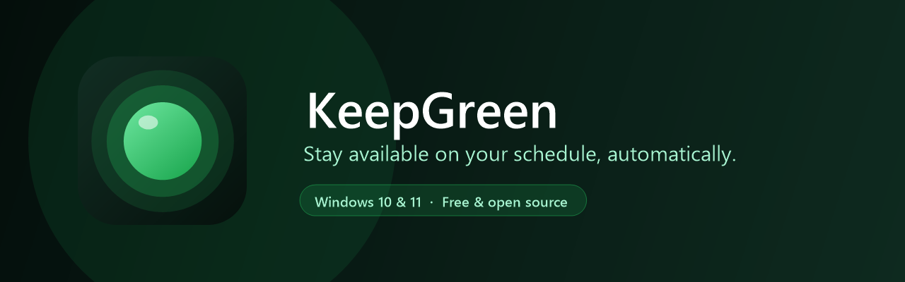
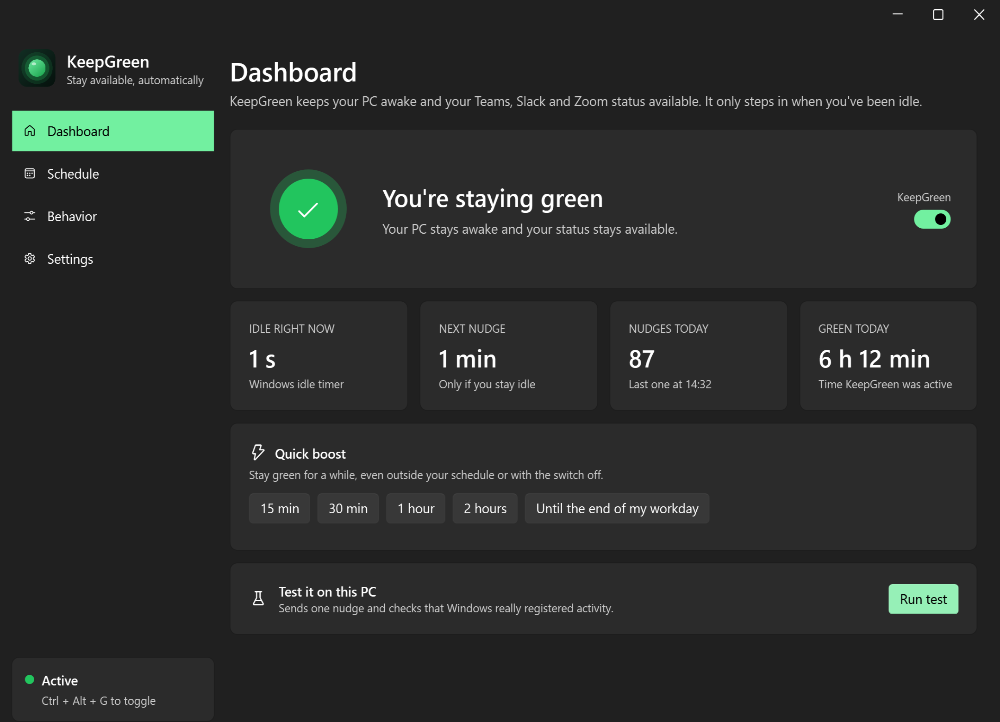
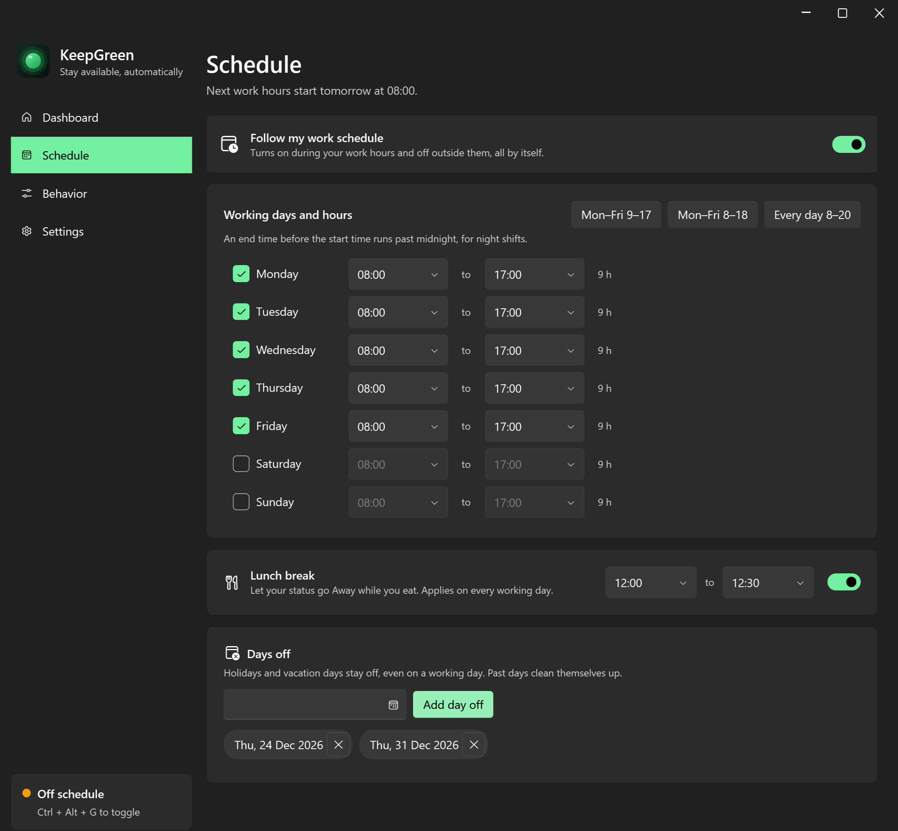
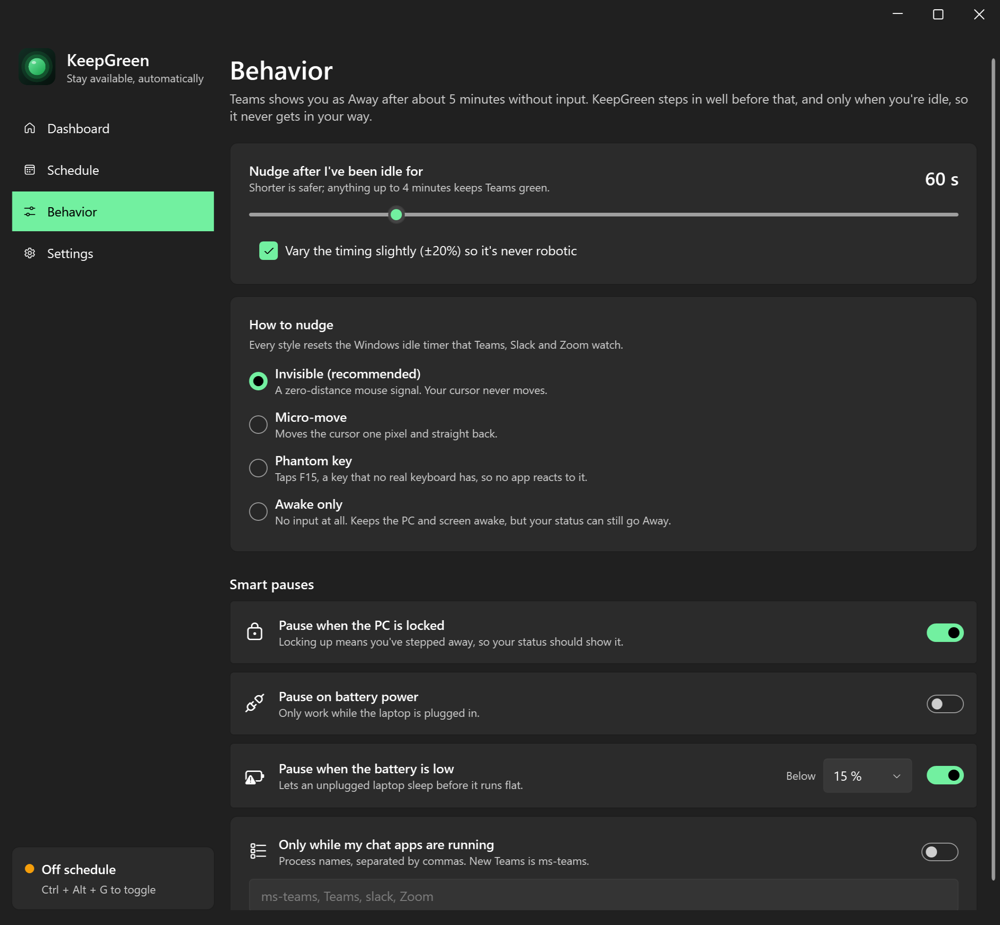

<p align="center">
  
</p>

<p align="center">
  <a href="https://github.com/m4hdhi/KeepGreen/releases"></a>
  <a href="https://github.com/m4hdhi/KeepGreen/actions/workflows/ci.yml"></a>
  
  <a href="LICENSE"></a>
</p>

**KeepGreen** keeps your computer awake and your Microsoft Teams, Slack and Zoom status *Available*, but only during **your** work hours. Stepping away for coffee no longer turns you yellow, your computer doesn't fall asleep mid-download, and when the workday ends KeepGreen switches itself off. It runs on **Windows** and **macOS**, and your **iPhone** or **Android** phone works as a remote control.

It is not a mouse jiggler that shoves your cursor around on a timer. KeepGreen watches the same idle timer that Teams watches. It does nothing while you work, and only sends one invisible signal after you've actually gone quiet.

<p align="center">
  
</p>

## Features

**Smart, not noisy**
- **Idle-aware nudges.** KeepGreen acts only after you've been idle for the time you choose (15 s to 4 min), so it never fights your mouse or keyboard.
- **Invisible by default.** A zero-distance signal resets the idle timer without moving your cursor. Prefer something else? Pick another nudge style, or *Awake only* to keep the computer on without touching your status.
- **Proof it works.** The built-in self-test sends one nudge and confirms the system registered it. If nudges ever stop registering, KeepGreen warns you instead of failing silently.

**On your schedule**
- **Working days and hours.** Each day has its own hours, with presets for *Mon–Fri 9–17*, *Mon–Fri 8–18* or *every day*.
- **Night shifts.** An end time before the start time simply runs past midnight.
- **Lunch break.** Let your status go Away while you eat.
- **Days off.** Add holidays and vacation days, and past ones clean themselves up.
- **Quick boosts.** Stay green for 15 min, 30 min, 1 h, 2 h or *until the end of my workday*, even outside your schedule.

**Thoughtful pauses**
- Pauses when you **lock your computer**, because you really are away.
- Pauses **on battery** or **below a battery level** you pick, so your laptop isn't drained.
- **App-aware:** optionally works only while Teams, Slack or Zoom are running.
- Survives **sleep and Modern Standby**, re-asserting itself after every wake.

**Your phone as a remote** <sup>new in 2.0</sup>
- See your computer's status live, flip the switch, or start and cancel a boost from your **iPhone** or **Android** phone.
- **Pair once with a 6-digit code**, or on a Mac just scan the QR code with the iPhone camera.
- **Private by design:** off by default, works only on your own Wi-Fi, and every command is signed (HMAC-SHA256), so nobody else on the network can control your computer. The protocol is [documented](docs/remote-api.md).
- **Android extra:** keep the phone's own screen awake for 15 min to "until I turn it off", from the app or a Quick Settings tile.

**Feels native everywhere**
- **Windows 10 & 11:** Fluent design with Mica, a status dot in the tray, and a **Ctrl + Alt + G** shortcut.
- **macOS 13+:** a SwiftUI menu-bar app.
- **iOS 16+ and Android 8+:** native SwiftUI and Jetpack Compose apps with light and dark themes.
- Starts with your computer, sends notifications when work hours start or end, and has **no telemetry, no account and no cloud**.

<p align="center">
  
  
</p>

## Download

Get everything from **[Releases](https://github.com/m4hdhi/KeepGreen/releases)**. The macOS and Android apps are new in the **2.0 beta**; if something doesn't work on your Mac or phone, please [open an issue](https://github.com/m4hdhi/KeepGreen/issues).

| Platform | File | Notes |
| --- | --- | --- |
| **Windows 10 / 11** | `KeepGreen-win-x64-standalone.exe` | Runs anywhere, nothing else to install. |
| | `KeepGreen-win-x64.exe` | Tiny download; needs the [.NET 10 Desktop Runtime](https://dotnet.microsoft.com/download/dotnet/10.0). |
| **macOS 13+** | `KeepGreen-macos.zip` | Unzip and move KeepGreen to Applications. It isn't notarized yet, so the first time open it with right-click → **Open**, or allow it under System Settings → Privacy & Security. |
| **Android 8+** | `KeepGreen-android.apk` | Install it from your phone's browser or Files app and allow installing apps when asked. |
| **iPhone (iOS 16+)** | Build from source | Open the Xcode project (see below) and run it on your iPhone. An App Store release is planned. |

> Windows SmartScreen may warn about a new, unsigned app. Choose **More info → Run anyway**, or build it yourself from source.

**Set up the phone remote:** on your computer open KeepGreen → *Settings* → *Phone remote* and turn it on. On the phone, add the computer with the address and 6-digit code it shows (or scan the Mac's QR code with the iPhone camera). Phone and computer must be on the same Wi-Fi. Windows may ask whether KeepGreen can use private networks; choose **Allow**.

## How it works

| Need | Windows | macOS |
| --- | --- | --- |
| Keep the computer awake | [`SetThreadExecutionState`](https://learn.microsoft.com/windows/win32/api/winbase/nf-winbase-setthreadexecutionstate) while active | An IOKit power assertion while active |
| Know how long you've been idle | [`GetLastInputInfo`](https://learn.microsoft.com/windows/win32/api/winuser/nf-winuser-getlastinputinfo), the signal Teams uses | `CGEventSource` idle time |
| Nudge only when idle | One tiny [`SendInput`](https://learn.microsoft.com/windows/win32/api/winuser/nf-winuser-sendinput) event | Declared user activity, or an invisible mouse event (needs Accessibility) |
| Never fail silently | Every nudge is verified a second later by checking that the idle timer really reset | Same |
| Phone remote | A tiny HTTP server on port 47321, signed requests | Network.framework server, same protocol |

The schedule and pause rules live in a pure, unit-tested core: [`KeepGreen.Core`](src/KeepGreen.Core) in C# and [`KeepGreenKit`](apple/KeepGreenKit) in Swift, with matching tests.

Teams switches to *Away* after about five minutes without input. KeepGreen's slowest setting (4 minutes, ±20%) still nudges in time.

**Why can't the phone apps keep Teams green on the phone itself?** iOS and Android don't let one app send activity to another, and app stores forbid tricks that try. On a phone, Teams shows *Available* while it's open on screen, so the Android app can keep the screen awake for you; the rest is the remote.

## Build from source

**Windows** (needs the [.NET 10 SDK](https://dotnet.microsoft.com/download/dotnet/10.0)):

```powershell
git clone https://github.com/m4hdhi/KeepGreen.git
cd KeepGreen
dotnet run --project src/KeepGreen                # run the app
dotnet run --project tests/KeepGreen.Tests        # run the tests
```

**macOS and iOS** (needs Xcode 16 and [XcodeGen](https://github.com/yonaskolb/XcodeGen)):

```bash
cd apple
(cd KeepGreenKit && swift test)                   # run the shared tests
brew install xcodegen && xcodegen generate        # create KeepGreen.xcodeproj
open KeepGreen.xcodeproj                          # run KeepGreenMac or KeepGreenRemote
```

**Android** (needs Android Studio, or Gradle 8.11 and JDK 17): open the `android` folder in Android Studio, or run `gradle assembleDebug testDebugUnitTest` inside it.

Project layout:

```
src/KeepGreen.Core       C# schedule, presence policy, settings and the remote protocol
src/KeepGreen            the Windows app (WPF + WPF-UI)
tests/KeepGreen.Tests    dependency-free tests for the C# core and remote server
apple/KeepGreenKit       Swift schedule, presence policy and remote client, with tests
apple/KeepGreenMac       the macOS menu-bar app (SwiftUI)
apple/KeepGreenRemote    the iPhone remote (SwiftUI)
android                  the Android app (Kotlin + Jetpack Compose)
docs/remote-api.md       the phone remote protocol all apps implement
tools/make-assets.ps1    renders the logo, icons and banner from code
```

A Debug build of the Windows app can re-render the README screenshots off-screen with sample data: `KeepGreen.exe --screenshots docs`.

## FAQ

**Does it work with Slack, Zoom or Discord?** Yes. Desktop apps that decide you're away from the system idle timer see KeepGreen's nudges. Chat apps running inside a browser tab may use their own activity checks.

**Will it type into my documents or move my cursor?** No. The default nudges don't move the cursor or type anything, and they only happen while you're idle.

**Can it keep me green while my computer is locked?** It pauses on lock by default, because a locked computer means you're away. You can turn that off, but many company policies lock the computer anyway.

**Is the phone remote safe?** It's off until you turn it on, only answers on your local network, and only accepts commands signed with a key your phone received when you paired. *Unpair all phones* replaces that key instantly.

**Where are my settings?** Windows: `%APPDATA%\KeepGreen\settings.json`. macOS: `~/Library/Application Support/KeepGreen`. Delete the folder to reset everything.

## Use it responsibly

KeepGreen changes how idle your computer looks, not how much you work. Follow your organization's IT and acceptable-use policies.

## Contributing

Issues and pull requests are welcome. If you're changing behaviour, put the logic in the shared core (`KeepGreen.Core` or `KeepGreenKit`) with a test, and keep [`docs/remote-api.md`](docs/remote-api.md) in sync with every app.

## License

[MIT](LICENSE) © 2026 [Mahdhi Muzammil](https://github.com/m4hdhi)

<p align="center"><b>If KeepGreen saves your green dot, give it a ⭐. It really helps!</b></p>
